# Архитектура habit-bot

Составлено по бизнес-требованиям, редакция 9 от 26.10.2026. Дополняет диаграмму развертывания (`claude/deployment-diagram.md`). Стек не меняется: Python 3.12, aiogram 3, SQLAlchemy + Alembic, SQLite, APScheduler, httpx, matplotlib и Pillow.

Редакция 2 (29.10.2026): ядро и модули отвязаны от Telegram. Ту же логику смогут использовать мобильное и веб-приложение. Сами интерфейсы приложения и веба — в следующих версиях.

## 1. Главная идея

Бот строится как **модульный монолит**. Это один процесс, один контейнер и одна база, но код разделён по двум направлениям.

**Модули — что умеет продукт.** Еда, зарядка, привычки, команды текстом, уведомления, а позже резюме чатов. Модуль описывает сценарии (use cases), правила и данные. Он не знает, нажал пользователь кнопку в Telegram или кнопку в приложении.

**Каналы — через что с продуктом работают.** Сейчас канал один: Telegram-бот. Позже появится HTTP API, которым будут пользоваться мобильное и веб-приложение. Канал принимает действие пользователя, вызывает сценарий модуля и показывает результат на своём языке: сообщением с кнопками, экраном приложения или страницей.

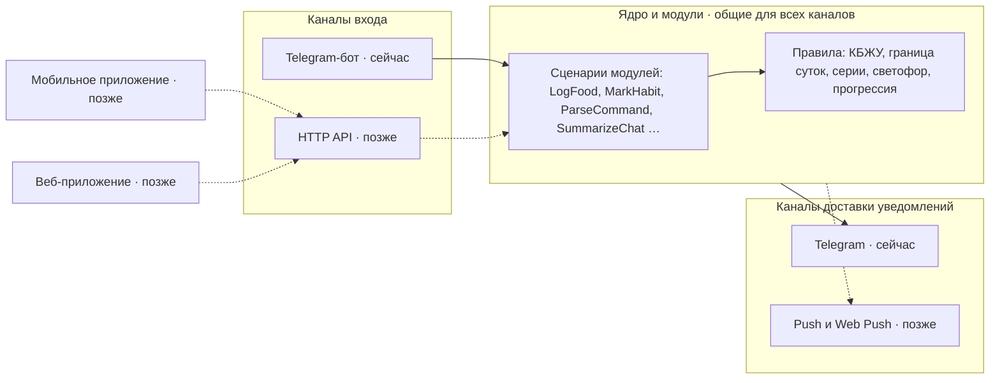

Новая функция — это новый пакет в `modules/` и одна строка в `ENABLED_MODULES`. Новый канал — это новый пакет в `channels/`. Ядро и уже написанные модули при этом не меняются.

Почему не микросервисы: у нас 1 vCPU и 1 ГБ памяти, до 20 пользователей и одна SQLite. Границы модулей и каналов проводим в коде, а линтер импортов проверяет, что их никто не нарушает. Если позже модуль или API понадобится вынести в отдельный процесс, граница для этого уже будет.

## 2. Слои

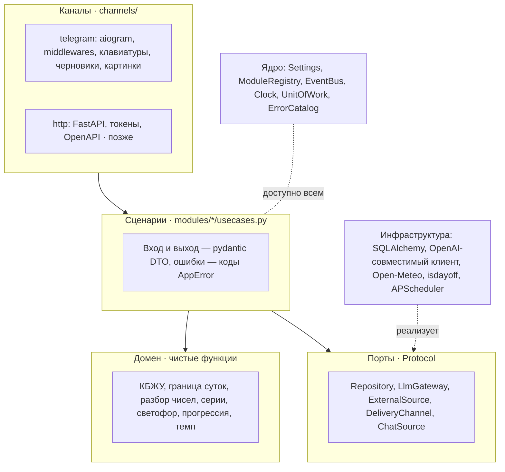

Правила слоёв:

- **Домен** не делает ввода-вывода и не импортирует aiogram и SQLAlchemy. Текущее время он получает аргументом, поэтому граница 04:00 тестируется без моков. По требованию 7.3 этот слой покрывается тестами на 100%.
- **Сценарии** принимают `Actor` (кто действует) и DTO. Возвращают они тоже DTO или `AppError` с кодом. Сценарий не принимает `Update` из Telegram, не возвращает текст для пользователя, клавиатуру или картинку.
- **Каналы** переводят действие пользователя в вызов сценария, а результат — в свой формат. Всё, что существует только в Telegram, живёт в канале: черновики, сброс через 15 минут, устаревшие кнопки, режим «Другой день», числа с запятой, картинки статистики.
- **Модули** обращаются друг к другу только через `public.py` или события. import-linter на шаге «1. Линтер» проверяет и это правило, и то, что `usecases.py` не импортирует aiogram.

## 3. Каналы: что общее, а что у каждого своё

| Что | Ядро, общее для всех каналов | Telegram, сейчас | Приложение и веб, позже |
|---|---|---|---|
| Кто пользователь | `User` и его `Identity` (способы входа) | `Identity` типа telegram по Telegram-ID, вход по приглашению | Вход через привязку к Telegram, затем токены сессии |
| Действие | Сценарий с DTO: `LogFood(day, item_id, qty, request_id)` | Кнопки, диалог по шагам, callback | HTTP-запрос с тем же DTO |
| Дата записи | `DayClock.record_date(started_at)` или явная дата | Режим «Другой день», кнопки «Вчера (24.10)» | Выбор даты на экране |
| Незаконченный ввод | Нет: сценарий выполняется целиком или не выполняется | Черновики, сброс через 15 минут, устаревание кнопок | Состояние формы на устройстве |
| Ответ | DTO результата, например `DayCardData` | Текст моноширинным блоком и кнопки | JSON, клиент рисует экран |
| Ошибки | `AppError(code, params)` из каталога 7.4 | Текст из каталога | `{code, params, message}` |
| Статистика | `StatsData`: ряды, клетки светофора, итоги | Картинка matplotlib с кэшем | Графики рисует клиент |
| Уведомления | `Notice`: заголовок, текст, действия | Сообщение с кнопками | Push или Web Push |
| Команды текстом | `CommandService` возвращает `ActionPlan` | Карточка «Понял так» | Тот же план, своя карточка |
| Экспорт | `CsvExporter` собирает файлы | Документы в чат | Скачивание файла |
| Числа и даты | `Decimal`, `date`, ISO 8601 | «77,5», «23.10, пт» | Формат устройства |

Правило из раздела 4.4 про проверку владельца работает во всех каналах: сценарий читает данные только через `UserScopedRepository`, привязанный к `Actor.user_id`. Проверка callback-данных в Telegram остаётся как дополнительная защита канала.

## 4. Что закладываем сейчас, чтобы потом не переделывать

Эти решения стоят недорого, пока базы и кода ещё нет. Если добавлять их после запуска, придётся переписывать данные и все сценарии.

| Решение | Цена сейчас | Что даст для приложения и веба |
|---|---|---|
| `Identity` отдельно от `User`: Telegram-ID переезжает из `User` в `Identity` | Одна таблица | Новый способ входа добавляется без миграции пользователей |
| Сценарии с pydantic DTO на входе и выходе | Дисциплина, лишнего кода нет | HTTP API становится тонкой обёрткой, OpenAPI собирается из тех же моделей |
| Внешний ID записи — UUID (`public_id`), а не порядковый номер | Колонка | Безопасные ссылки в API, создание записи на телефоне без связи |
| `updated_at` и `deleted_at` у пользовательских записей | Две колонки и фильтр в `UserScopedRepository` | Синхронизация «что изменилось с …» для приложения |
| Ключ идемпотентности `request_id` у сценариев, которые меняют данные | Таблица ключей за 24 часа | Повтор запроса при плохой сети не создаёт дубль. В Telegram это защищает от двойного нажатия |
| Поле `version` у редактируемых сущностей: профиль, рецепт, привычка, уведомление, план | Колонка | Правка с двух устройств без молчаливой потери изменений |
| Уведомления как `Notice` и каналы доставки | Интерфейс вместо прямого вызова Telegram | Push добавляется одним классом |
| Статистика возвращает данные, картинку рисует Telegram-канал | Разделение и так нужно для тестов | Графики в приложении без matplotlib на сервере |
| Часовой пояс в профиле, по умолчанию Europe/Moscow | Поле | Пользователи из других поясов. Требования при этом не меняются |
| Тексты по ключам из каталога | Уже есть в требованиях (7.4) | Клиенты показывают свои формулировки по тем же кодам |

Мягкое удаление (`deleted_at`) касается только отдельных записей: удалённая запись хранится 30 дней как отметка для синхронизации. Удаление аккаунта, как и раньше, стирает все строки пользователя сразу.

### Что это меняет в требованиях

Внесено в требования, редакция 10 от 03.11.2026. Раздел 7.5 обновлён по итогам части 2, раздел 12 — по частям 2–4 (04.11.2026).

- **Раздел 5, User:** `tg_id` переезжает в новую сущность `Identity(user_id, provider, external_id)`. Поле «дата режима «Другой день»» переезжает в состояние диалога Telegram-канала.
- **Раздел 5, пользовательские таблицы:** добавить `public_id`, `updated_at`, `deleted_at`, а у редактируемых — `version`.
- **Раздел 5, Profile:** добавить `timezone` со значением по умолчанию Europe/Moscow.
- **Новая таблица `IdempotencyKey`:** `user_id`, `request_id`, ответ, время создания. Записи хранятся 24 часа.
- **Раздел 7.3, правило «открыт только SSH»** сохраняется до появления API.

## 5. Структура репозитория

```text
habit_bot/
  main.py                  сборка: Settings → Container → ModuleRegistry → включённые каналы
  kernel/
    config.py              Settings (pydantic-settings), полный список ошибок CFG-* сразу
    container.py           сборка зависимостей
    modules.py             Module, ModuleContext, ModuleRegistry
    channels.py            Channel, ChannelRegistry
    identity.py            User, Identity, Actor, Role
    events.py              EventBus, DomainEvent
    clock.py               Clock, DayClock (часовой пояс пользователя, граница 04:00)
    db.py                  Base, UnitOfWork, UserScopedRepository, IdempotencyStore
    errors/catalog.py      ErrorCode, AppError — каталог раздела 7.4
    domain/                общие чистые функции: разбор и формат чисел, времени, дат
    jobs.py                JobSpec — фоновые задачи по расписанию
  platform/                общие сервисы без привязки к каналу
    habits/                HabitKind, HabitRegistry, Progress, серии, светофор
    ai/                    LlmGateway, LlmRouter, BudgetGuard, AiActionRegistry, CommandService
    notify/                NotificationProvider, NotificationService, Notice
    delivery/              DeliveryChannel, DeliveryRouter, Outbox
    stats/                 StatsProvider, StatsData
    export/                ExportTable, CsvExporter, README.csv
    sources/               ExternalSource, SourceCache, OpenMeteo, IsDayOff
    alerts/                AdminAlerter (склейка одинаковых ошибок за час)
  channels/
    telegram/              всё, что знает про aiogram
      channel.py           TelegramChannel: Dispatcher, polling, middlewares
      dialogs/             DialogState, DialogStore, DbFsmStorage, сброс 15 мин, «Другой день», /check
      ui/                  MenuRegistry, Screens, данные кнопок (o, t), проверка кнопок
      render/              карточка дня, картинки статистики, карточка «Понял так»
      delivery.py          TelegramDelivery(DeliveryChannel)
    http/                  позже: FastAPI, токены, OpenAPI. Сейчас пакета нет
  modules/
    users/                 приглашения, анкета, профиль, цели КБЖУ, роли
    days/                  выходной, перенос записей, карточка дня
    food/   warmup/   workouts/   runs/   custom_habits/
    stats_views/           сценарии «Итоги»
    ai_commands/           команды текстом и заполнение через ИИ
    notifications/         свои и готовые уведомления
    admin/   export/   backup/
    chat_digest/           будущий модуль: резюме чатов
migrations/                Alembic, одна цепочка ревизий
tests/                     unit/ (домен), usecases/ (сценарии без канала), telegram/ (поддельный Telegram)
```

Каждый модуль устроен одинаково, поэтому новый модуль делается по шаблону:

```text
modules/food/
  module.py      FoodModule(Module): регистрирует всё, что ниже
  models.py      FoodItem, FoodEntry (SQLAlchemy)
  repo.py        FoodRepository(UserScopedRepository)
  domain/        расчёт КБЖУ, разбор строки «Другое» — чистый код
  dto.py         LogFoodIn, FoodEntryOut, DayCardData — pydantic
  usecases.py    LogFood, ChangeQty, MoveEntry, DeleteEntry, ListItems — без aiogram
  kind.py        FoodKind(HabitKind): прогресс дня для главного экрана, статистики и уведомлений
  ai_actions.py  food.add, food.change_qty, food.delete, food.move и контекст для модели
  stats.py       StatsData для дня и строки светофора
  export.py      food.csv
  public.py      то, что можно вызывать из других модулей
  telegram/      handlers.py, keyboards.py, views.py — только Telegram
```

Когда появится HTTP API, в модуль добавится папка `http/` с роутами поверх тех же `usecases.py`. Остальные файлы модуля не изменятся.

## 6. Точки расширения

| Что добавляем | Что реализовать | Где регистрируется | Пример |
|---|---|---|---|
| Свою привычку | Ничего: это данные (`Habit`, `HabitEntry`) | Пользователь в настройках | 💧 Вода, 😴 Сон |
| Встроенный вид привычки со своим вводом | `HabitKind` и модуль | `ctx.habits` | Медитация с таймером |
| Сценарий | Класс в `usecases.py` с DTO | `ctx.usecases` | `SummarizeChat` |
| Действие для команд текстом | `AiAction`: схема, проверка, выполнение, отмена | `ctx.ai_actions` | `chat.summarize` |
| Данные для модели | `AiContextProvider` | `ctx.ai_context` | Названия рецептов, список чатов |
| Задачу ИИ со своей моделью | `AiTask` и маршрут в `LLM_ROUTES` | `.env` | Резюме у другого провайдера |
| Готовое уведомление | `NotificationProvider` | `ctx.notifications` | 🌤 Погода, 📰 Резюме чатов |
| Данные статистики | `StatsProvider` | `ctx.stats` | e1RM, км за неделю |
| Таблицу экспорта | `ExportTable` | `ctx.exports` | `chat_summaries.csv` |
| Внешний источник данных | `ExternalSource`: таймаут 5 с, кэш 1 ч, работа без него | Контейнер | Курс валют |
| Фоновую задачу | `JobSpec` | `ctx.jobs` | Удаление сообщений старше 72 ч |
| Реакцию на событие | Подписка на `DomainEvent` | `ctx.events` | Рекорд → уведомление 🏆 |
| Кнопку, экран или картинку в Telegram | Роутер, `MenuEntry`, `StatsImage` | `ctx.channel("telegram")` | «💬 Чаты» |
| Канал входа | `Channel` | `ENABLED_CHANNELS` | HTTP API, Telegram Mini App |
| Канал доставки | `DeliveryChannel` | `ctx.delivery` | Push (FCM, APNs), Web Push, почта |
| Способ входа | `IdentityProvider` | Модуль `users` | Привязка через бота, Telegram Login |
| Источник сообщений чатов | `ChatSource` | Модуль `chat_digest` | Группа, Telegram Business |

Модуль сам говорит, на каком он этапе (`MVP`, `V2`, `V3`, `LAB`) и от каких модулей зависит. Если модуль выключен, его сценарии, кнопки, задачи и действия ИИ не регистрируются, а таблицы и данные остаются в базе.

```python
class Module(ABC):
    key: ClassVar[str]                      # "food"
    stage: ClassVar[Stage]                  # Stage.MVP
    depends_on: ClassVar[tuple[str, ...]] = ()

    @abstractmethod
    def register(self, ctx: ModuleContext) -> None: ...


class FoodModule(Module):
    key, stage = "food", Stage.MVP
    depends_on = ("users", "days")

    def register(self, ctx: ModuleContext) -> None:
        uc = FoodUseCases(ctx.uow, ctx.day_clock, ctx.events, ctx.idempotency)
        ctx.usecases.add(uc)
        ctx.habits.add(FoodKind(uc))
        ctx.ai_actions.add(FoodAdd(uc), FoodChangeQty(uc), FoodDelete(uc), FoodMove(uc))
        ctx.ai_context.add(FoodContext())
        ctx.stats.add(FoodDayStats(), FoodTrafficRows())
        ctx.exports.add(FoodCsv())

        if tg := ctx.channel("telegram"):        # канал включён — добавляем его часть
            tg.add_router(food_router(uc))
            tg.add_menu(MenuEntry("food", "🍽 Еда", order=10))
            tg.add_stats_image("food.day", FoodDayImage())
        # Когда появится HTTP API:
        # if http := ctx.channel("http"):
        #     http.add_router(food_api(uc))
```

У `Module` один метод `register(ctx)`. Модуль сам спрашивает, какие каналы включены, и добавляет в них свою часть. Если появляется новый канал или новая точка расширения, интерфейс модуля и уже написанные модули не меняются.

## 7. Диаграммы классов

### 7.1 Ядро, модули и каналы

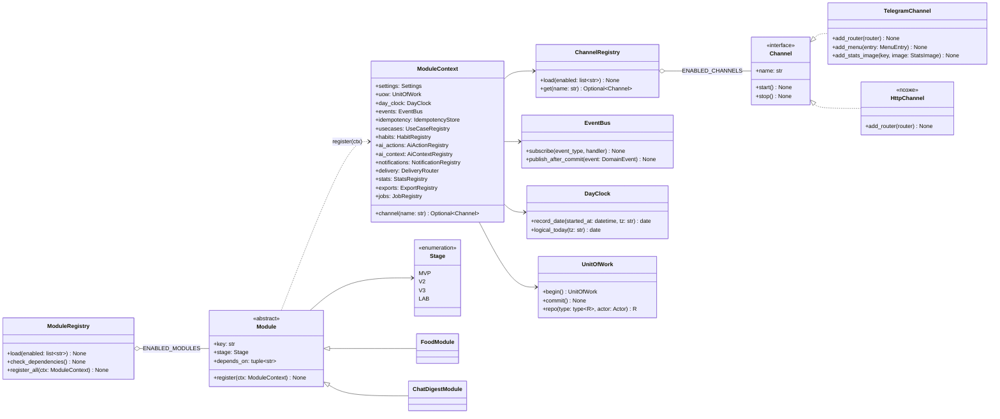

`ChannelRegistry` загружает каналы из `ENABLED_CHANNELS`. Сейчас там только `telegram`. Модуль, которому нужен канал, получает его через `ctx.channel(...)`. Если канал выключен, модуль просто пропускает эту часть регистрации.

### 7.2 Пользователь и вход

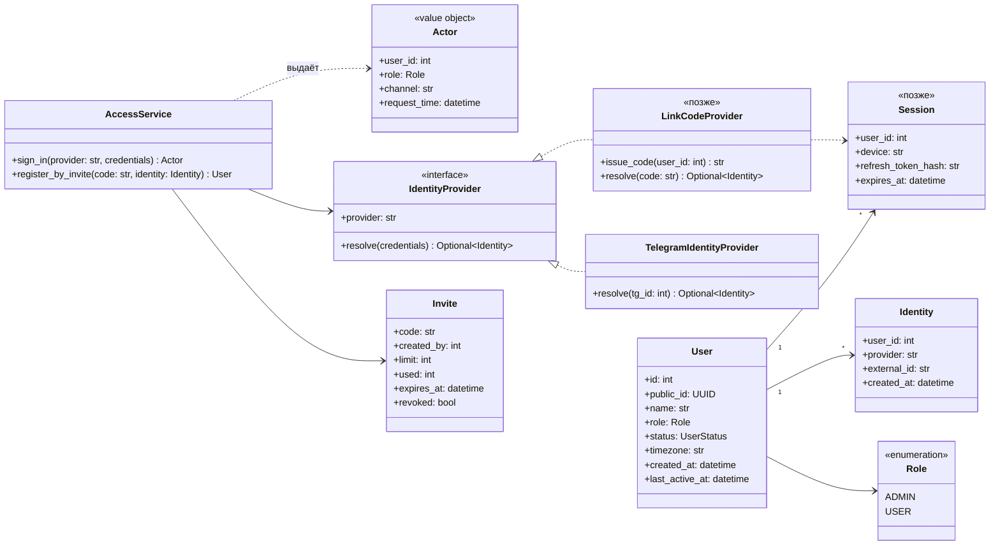

Сейчас есть одна `Identity` типа telegram. Администратор по-прежнему определяется списком `ADMIN_TG_IDS`: при старте `AccessService` ищет пользователей по `Identity(provider="telegram")`. Когда появится приложение, к тому же пользователю добавится вход через привязку: пользователь нажимает «Войти через Telegram», бот присылает код или кнопку подтверждения, и приложение получает сессию (`Session`). Регистрация по приглашению остаётся единственным способом попасть в бот.

### 7.3 Сценарии: один код для всех каналов

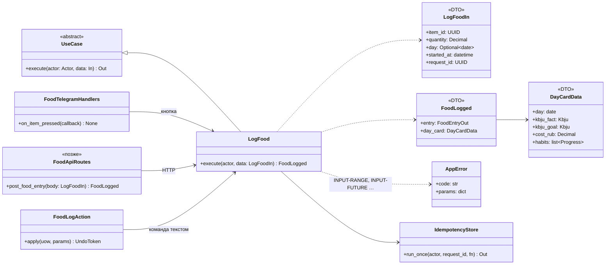

Один и тот же `LogFood` вызывают три входа: кнопка в Telegram, будущий HTTP API и действие ИИ из команды текстом. Проверки, расчёт КБЖУ, копирование цены и событие `FoodLogged` живут в одном месте. Если `day` не передан, сценарий считает дату по `started_at` и границе 04:00 в часовом поясе пользователя.

### 7.4 Привычки: единый интерфейс

По требованиям главный экран, статистика и уведомления работают со всеми привычками одинаково. Поэтому каждый вид привычки отвечает на одни и те же вопросы через `HabitKind`. Как привычка выглядит на экране, решает канал, а не модуль.

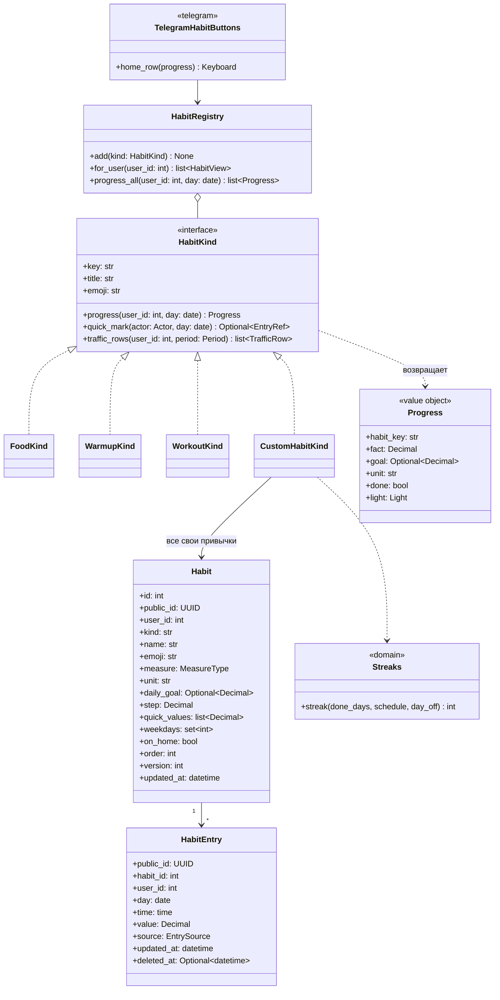

Встроенные привычки (еда, зарядка, тренировка) по требованиям тоже лежат строками в `Habit` с полем `kind`. По этому полю `HabitRegistry` находит класс, который считает прогресс. Бег учитывается в `WorkoutKind` через `runs.public`. Цель «N раз в неделю» из v2 добавляется полем `weekly_goal` и веткой в `Streaks`, а интерфейс не меняется.

### 7.5 Telegram-канал: диалоги и интерфейс

Всё на этой диаграмме существует только в Telegram. Приложению и вебу оно не понадобится: у них состояние формы хранится на устройстве, а сценарий получает уже готовые данные. Построено в части 2.

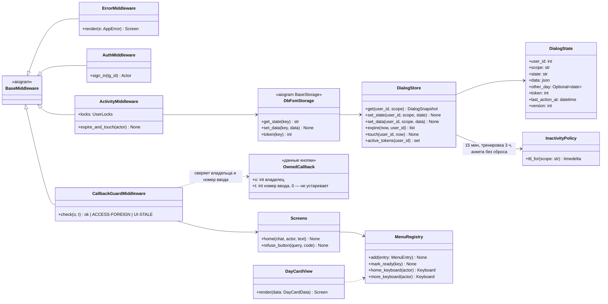

Как это работает:

- **Порядок.** Внешние middleware апдейта: ошибки → вход (модуль `users`) → бездействие. `ActivityMiddleware` сначала молча удаляет просроченный ввод пользователя, затем продлевает оставшийся и кладёт в обработчик `state` (FSMContext aiogram). Апдейты одного пользователя обрабатываются по очереди (`UserLocks`), поэтому два быстрых нажатия не перепишут ввод друг другу.
- **Хранилище.** Встроенное хранилище aiogram выключено (`Dispatcher(disable_fsm=True)`). Ключ `DbFsmStorage` строится по `user_id` бота, а не по Telegram-ID: Telegram-ID хранится только в `Identity`. `destiny` ключа — область ввода: `default` → `dialog`, остальные — `other_day`, `workout`, `onboarding`.
- **Сброс.** `InactivityPolicy` задаёт срок по области. Сброс идёт при каждом действии пользователя и фоновой задачей раз в минуту (`JobSpec` в `ModuleContext.jobs`), а также сразу при старте бота — поэтому срабатывает и после перезапуска. Для `workout` (часть 8) к сбросу добавится «завершить с записанными подходами», для `other_day` (часть 4) — отметка для «📅 Нет, за 24.10».
- **Устаревание кнопок.** Новая строка `DialogState` получает случайный `token`; кнопки ввода несут его в поле `t`. После отмены, сброса или нового ввода (`start_dialog`) строки с этим номером нет, и `CallbackGuardMiddleware` отвечает `UI-STALE` с главным меню. Кнопки сохранённых записей (часть 5) несут `t = 0` и не устаревают.
- **Владелец.** Поле `o` сверяется с нажавшим; при расхождении — `ACCESS-FOREIGN`, ничего не меняется. Это дополнительная защита канала: сценарии всё равно читают данные через `UserScopedRepository`.
- **Меню.** `MenuRegistry` хранит пункты главного меню и «Ещё». Пока раздела нет, ядро отвечает «скоро» с номером части плана. Модуль, подключая раздел, вызывает `mark_ready(key)` и обрабатывает кнопку своим роутером. Переход в раздел меню закрывает незаконченный ввод.
- **Разбор ввода** — чистые функции `kernel/domain/parsing.py` и `formatting.py` (числа с точкой и запятой, время, даты, логический день с границей 04:00). Ими же будут пользоваться приложение и веб.

`TgSession.started_at` (часть 4) берётся из даты сообщения Telegram, поэтому ввод, начатый в 03:58, остаётся в предыдущем дне. Режим «Другой день» хранится в `DialogState`, и канал передаёт выбранную дату в сценарий явным параметром `day`.

### 7.6 ИИ: задачи, действия, бюджет

ИИ используется для разных **задач**, и у каждой задачи свой маршрут к модели и свой бюджет. Команды текстом собираются из **действий**, которые регистрируют модули. План действий — это обычный DTO, поэтому карточку «Понял так» сможет показать любой канал.

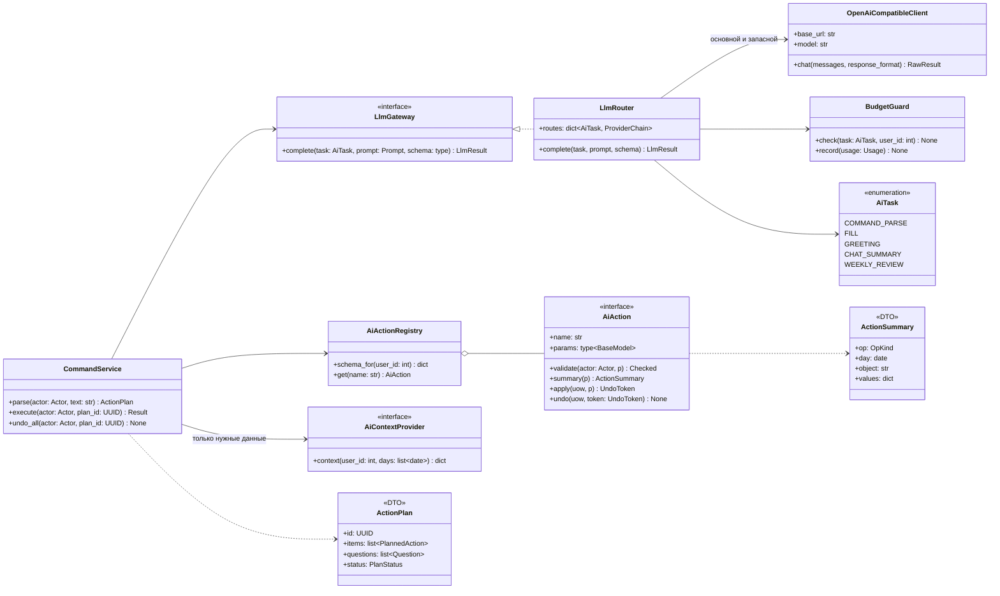

- **Маршруты по задачам.** `LLM_ROUTES` в `.env` задаёт для каждой задачи провайдера, модель и запасной вариант. Если маршрут не задан, используется `LLM_*` по умолчанию, как в требованиях 7.2.
- **Бюджет.** Общий лимит в 5 $ в месяц остаётся, но `BudgetGuard` дополнительно ведёт доли по задачам. Поэтому новая функция не может съесть бюджет на разбор команд.
- **Действия.** `summary()` возвращает структуру, а не готовую строку. Telegram собирает из неё «➕ 24.10 Еда: Куриное бедро × 2 — 500 ккал», а приложение нарисует свою карточку.

### 7.7 Уведомления и доставка

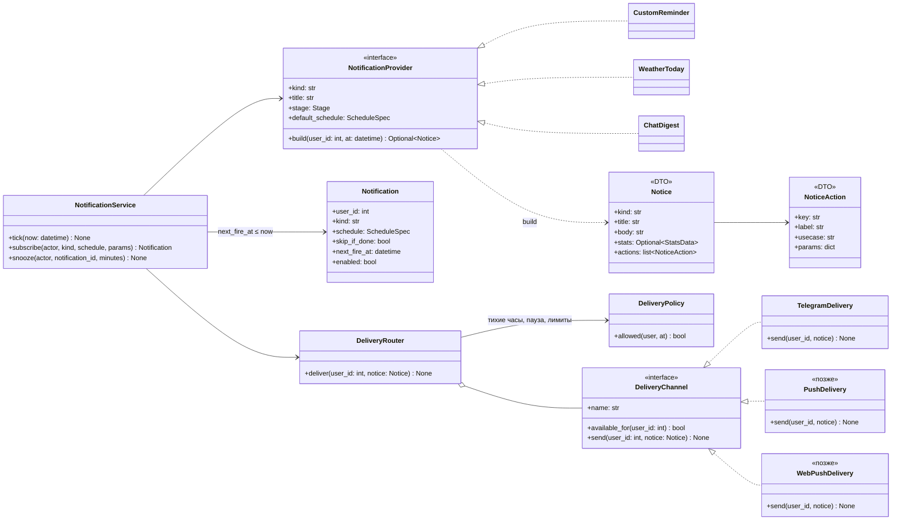

Вместо отдельной задачи APScheduler на каждое уведомление работает **одна задача раз в минуту**: `NotificationService.tick(now)`. Она выбирает из БД уведомления, у которых уже наступило время отправки (`next_fire_at`), получает от провайдера `Notice` и передаёт его в `DeliveryRouter`. Расписание живёт в БД, поэтому переживает перезапуск, а точность остаётся в пределах ±1 минуты.

Кнопки уведомления описаны как `NoticeAction`, то есть ссылка на сценарий с параметрами, например `habit.mark` с `habit_id`. Telegram превращает действие в callback-кнопку, push — в кнопку уведомления, и обе вызывают один и тот же сценарий. Сейчас доставка только в Telegram. Когда появится приложение, добавятся `PushDelivery` и настройка «куда присылать».

### 7.8 Статистика: данные отдельно от картинки

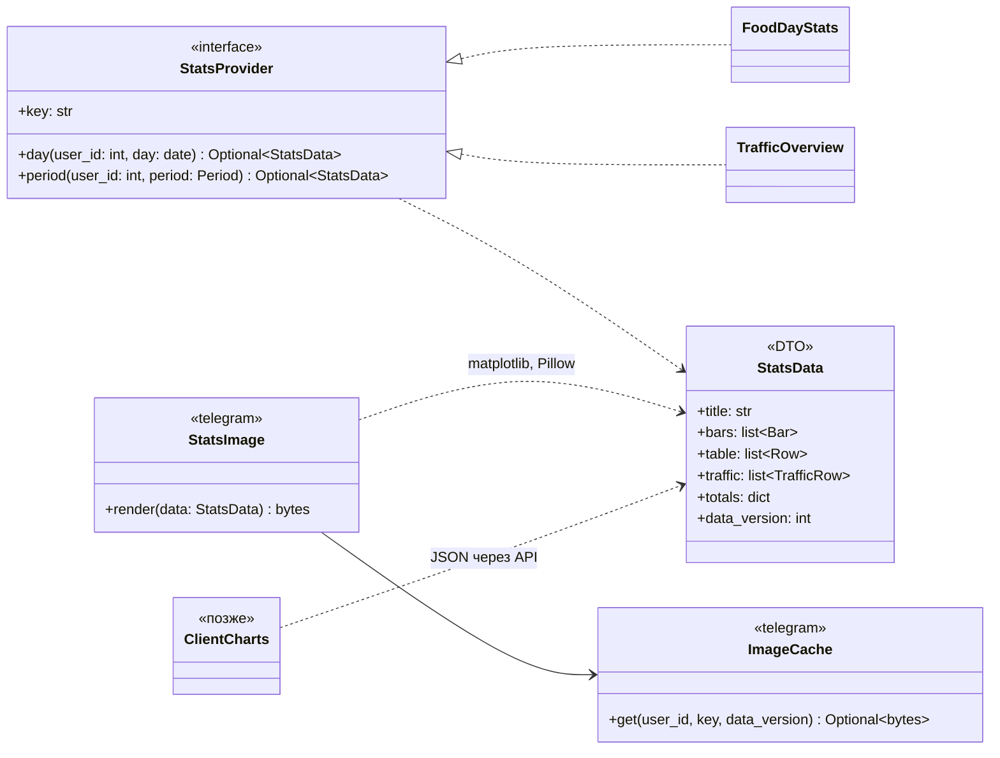

Модули считают данные (`StatsData`), а рисует их канал. Telegram строит картинку matplotlib и кэширует её по версии данных, как требует раздел 7. Приложение получит те же данные в JSON и нарисует графики само. Требование «при построении статистики нет запросов к ИИ» проверяется на уровне `StatsProvider`, то есть для всех каналов сразу.

### 7.9 Пример расширения: модуль «Резюме чатов»

Модуль добавляется без изменений в ядре. Он реализует уже существующие интерфейсы (`Module`, `UseCase`, `AiAction`, `NotificationProvider`, `ExportTable`, `JobSpec`) и добавляет один новый порт — `ChatSource`. Источники сообщений есть только в Telegram, а читать резюме можно будет из любого канала.

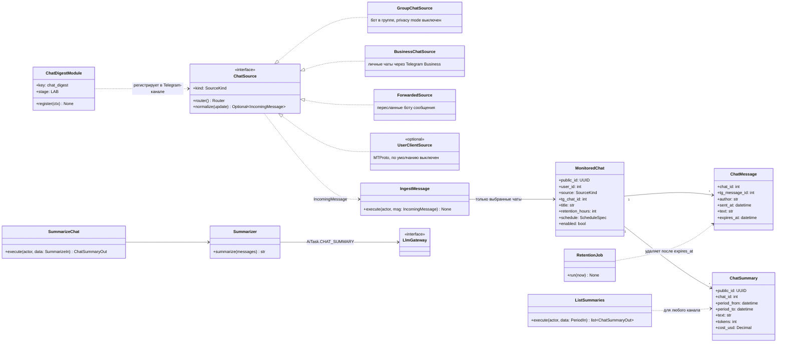

## 8. Ключевые потоки

### 8.1 Один сценарий, разные каналы

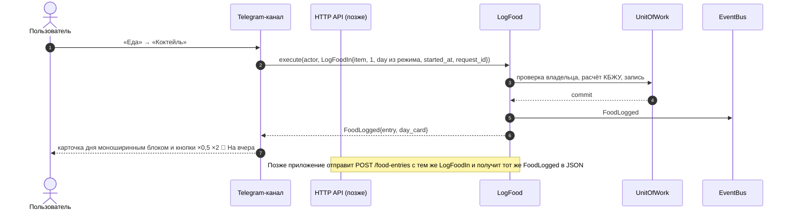

### 8.2 Команда текстом

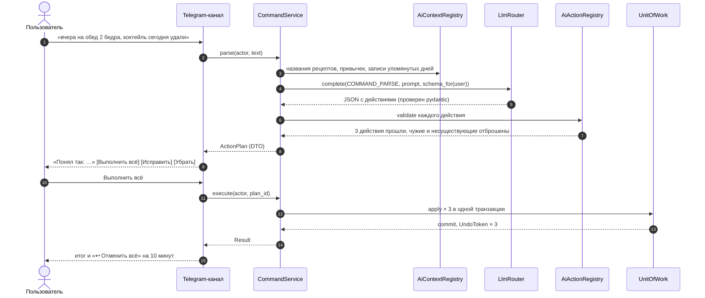

### 8.3 Нажатие кнопки

Апдейт Telegram проходит цепочку middleware и превращается в `Actor`. Роутер модуля в Telegram-канале собирает DTO и вызывает сценарий. Сценарий меняет данные в одной транзакции `UnitOfWork`. После `commit` публикуются события, например `FoodLogged` или `RecordSet`. На них подписаны кэш картинок статистики (он сбрасывается по версии данных), уведомления о рекордах и сериях и будущий еженедельный разбор. Канал рисует ответ из DTO: карточку дня из `DayCardData`.

## 9. Резюме чатов: что нужно решить заранее

Модуль «Резюме чатов» ложится в архитектуру без доработки ядра, но у Telegram есть ограничения: бот не видит переписку пользователя просто так. Возможные источники сообщений:

| Источник | Что видит бот | Условия | Оценка |
|---|---|---|---|
| Группа, куда добавлен бот | Все новые сообщения группы | Выключить privacy mode у @BotFather или сделать бота администратором группы. Участники должны знать, что бот читает | Подходит для семейных и рабочих групп |
| Telegram Business | Новые сообщения в выбранных личных чатах с момента подключения | Пользователь подключает бота в настройках Telegram для бизнеса; нужна подписка Premium. Групп нет, старой истории нет | Лучший вариант для личных чатов |
| Пересланные сообщения | Пачку сообщений, которую пользователь переслал боту | Без настроек, работает везде | Резюме по запросу, без хранения |
| Пользовательский клиент (MTProto) | Всю переписку аккаунта | Бот хранит сессию — по сути ключ от всего аккаунта Telegram | Не рекомендую: риск утечки и блокировки, противоречит принципу минимума данных |

Что модуль добавляет к требованиям:

- **Приватность.** Это переписка третьих лиц, а DeepSeek — китайский провайдер (раздел 7.2). Решение: для `CHAT_SUMMARY` отдельный маршрут в `LLM_ROUTES`, а в модель уходят только имя автора и текст, без Telegram-ID.
- **Хранение.** Требование «все данные только в БД» сохраняется. Сообщения лежат в `ChatMessage` с `expires_at` (по умолчанию 72 часа) и удаляются после резюме. Остаются только резюме.
- **Нагрузка.** Оценка на 10 чатов по 300 сообщений в день: около 12 тыс. токенов на чат в день, то есть ≈ 3,6 млн токенов в месяц. Это ≈ 0,5–1 $ в месяц на DeepSeek. Место в БД — десятки мегабайт при хранении 72 часа, для SQLite и VPS это немного.
- **Бюджет.** Отдельная доля резюме в `BudgetGuard`. Если она закончится, резюме остановятся, а команды текстом продолжат работать.
- **Удаление аккаунта** каскадно стирает подключённые чаты, сообщения и резюме. В экспорт добавляется `chat_summaries.csv`.

По этому же шаблону подключаются и другие функции ассистента: голосовые команды (порт `SpeechToText` и существующий `CommandService`), еженедельный разбор (`AiTask.WEEKLY_REVIEW` и уведомление), напоминания из календаря (`ExternalSource` и `NotificationProvider`).

## 10. Когда появятся приложение и веб

Интерфейсы приложения и веба в эту версию не входят. Ниже — что придётся сделать на сервере, когда до них дойдёт очередь. Сам код модулей при этом не меняется.

| Задача | Что сделать | Затронет |
|---|---|---|
| HTTP API | Пакет `channels/http` (FastAPI) и папки `http/` в модулях поверх тех же сценариев. API работает в том же процессе и том же цикле asyncio, что и бот: на 1 ГБ памяти это дешевле второго контейнера | Только новые файлы |
| Вход | `LinkCodeProvider`: «Войти через Telegram» в приложении, подтверждение в боте, затем токены `Session`. Для веба можно добавить вход через Telegram Login Widget | Модуль `users` |
| Push | `PushDelivery` (FCM для Android, APNs для iOS), `WebPushDelivery`, токены устройств, настройка «куда присылать» | `platform/delivery` |
| Синхронизация | Запрос «изменения с момента T» по `updated_at` и `deleted_at`; создание записей офлайн по `public_id` и `request_id` | Только API: поля уже заложены |
| Развёртывание | Домен, HTTPS через обратный прокси с автоматическим сертификатом, открыть порт 443 в файрволе. Это меняет правило «открыт только SSH» из раздела 7.3 | Диаграмма развертывания, bootstrap |
| База | Пока API и бот работают в одном процессе, SQLite хватает. Если API вынесут в отдельный процесс или вырастет нагрузка — переход на PostgreSQL: схема уже совместима | Конфиг и миграции |
| Промежуточный шаг | Telegram Mini App: веб-интерфейс внутри Telegram. Вход по подписанным данным от Telegram, без отдельного логина. Использует тот же HTTP API | Канал `http` |

## 11. Правила, которые держат архитектуру

1. Текущее время берётся только из `Clock`, дата записи — только из `DayClock.record_date`. Прямой `datetime.now()` запрещён правилом линтера.
2. Пользовательские данные читаются только через `UserScopedRepository`, привязанный к `Actor`. Каталог (`user_id = NULL`) — через отдельный `CatalogRepository`: только чтение и копирование.
3. Сценарии и домен не импортируют aiogram, FastAPI и другие библиотеки каналов. Это проверяет import-linter.
4. Сценарий принимает и возвращает DTO. Форматирование чисел и дат, тексты кнопок и картинки — только в канале.
5. Одно действие пользователя — одна транзакция. События публикуются после `commit`.
6. Каждый сценарий, который меняет данные, принимает `request_id` и выполняется через `IdempotencyStore`.
7. Тексты для пользователя и администратора берутся из каталога по коду (раздел 7.4).
8. Модуль не импортирует `models`, `repo` и `usecases` другого модуля — только его `public.py`.
9. Модели модуля лежат в модуле, миграции идут одной цепочкой Alembic. Таблицы модуля начинаются с его ключа, например `chat_digest_message`.
10. Каждый внешний вызов идёт через порт с таймаутом, повтором и кэшем. В CI порты заменяются фейками, реальных запросов к Telegram и модели нет.

## 12. Как это ложится на план MVP (раздел 8.1)

| Часть | Что строится из архитектуры |
|---|---|
| 1. Каркас | `kernel/`: Settings, ModuleRegistry, ChannelRegistry, UnitOfWork, IdempotencyStore, User и Identity, ErrorCatalog, AdminAlerter, логи; `channels/telegram/channel.py`; регистрация администратора через `Identity` |
| 2. Диалоги ✅ | `channels/telegram/dialogs` и `ui`: ActivityMiddleware, DialogStore + DbFsmStorage, сброс 15 минут, CallbackGuardMiddleware, MenuRegistry, Screens; `kernel/domain` — разбор и формат чисел, времени и дат; `kernel/jobs` — фоновые задачи |
| 3. Регистрация ✅ | Модуль `users`: `SignInTelegram` (вход по приглашению из ссылки `/start КОД`), `Invites`, `Profiles` (анкета, профиль, цели, удаление аккаунта — общая очистка всех таблиц с `user_id`), домен `kbju`, `city`, `invites`, `profile`; таблицы `users_profile`, `users_goal`, `users_invite`, `users_body_weight`; `platform/sources`: `OpenMeteoGeocoder` + `CachedGeocoder` (кэш 30 дней в `source_cache`). Анкета — область `onboarding`, её роутер подключается раньше меню (`add_router(first=True)`) |
| 4. Дни ✅ | Модуль `days`: `Days` (выходные `days_status`, карточка дня `DayCardData` с разделами `add_card_section`, перенос записей `add_mover` / `EntryMover`); `kernel/domain/days.py` — подписи, календарь, давность. `ActivityMiddleware` кладёт в обработчик `today` и `record_day` (по времени сообщения, граница 04:00; в «Другом дне» — выбранная дата; ввод помнит дату начала `start_dialog(..., day)`). Области `other_day` и `lost_day` (отметка на 12 ч после сброса). `Screens.home` строит клавиатуру по выбору пользователя (`users_profile.home_buttons`) и с кнопкой «📅 23.10 ✕ Вернуться к сегодня» |
| 5–8 | Модули `food`, `warmup`, `custom_habits`, `workouts` и `runs`. Каждый пишет сценарии с DTO, `HabitKind`, `StatsProvider`, экспорт и папку `telegram/`, а также сразу готовит `ai_actions.py` |
| 9. ИИ | `platform/ai`: LlmRouter, BudgetGuard, AiActionRegistry, CommandService; модуль `ai_commands` |
| 10. Итоги | `platform/stats` и `platform/export`; картинки в `channels/telegram/render`; модули `stats_views`, `admin`, `export`, `backup` |
| v2–v3 | `platform/delivery` и модуль `notifications` с провайдерами; новые модули `chat_digest`, `weekly_review`, `voice` |
| Следующие версии | `channels/http`, вход через привязку, push — раздел 10 |

Части 1–4 делают ядро, платформу и Telegram-канал, поэтому в них закладывается почти вся расширяемость. Начиная с части 5 каждая функция — это отдельный модуль по шаблону из раздела 5. Сценарии тестируются отдельно от канала (`tests/usecases/`), и потом этими же проверками будет закрыт HTTP API.
