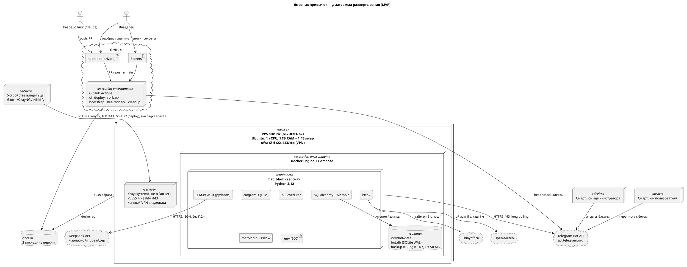

# Диаграмма развертывания habit-bot

По бизнес-требованиям, ред. 10 (03.11.2026), разделы 7.1–7.4. На сервере хранится только последний бэкап.
Страница со схемами: https://claude.ai/artifact/AAdgXmuUUzL7iJMErRz4DJ

